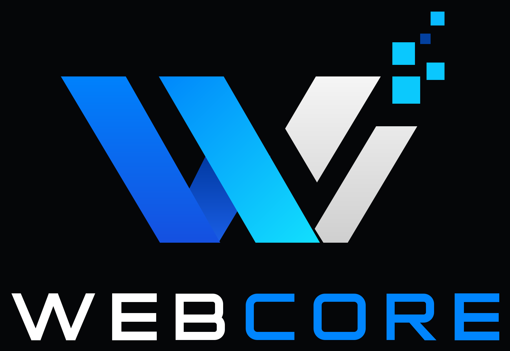

# WebCore — брендбук

WebCore — маркетинговое агентство: сайты, реклама и автоматизация в одних руках. Слоган — **Build. Promote. Automate.** Бренд выглядит как его логотип: почти чёрный фон, электрический синий и голубой, серебро, угловатые диагонали и «пиксели». Всё, что выходит от имени WebCore — посты, сторис, обложки, коммерческие предложения, сайт, — собирается из этих токенов и правил.

## 1. Голос и тексты

- **От первого лица.** Это личный блог основателя: «я сделал», «я проверяю», а не «наша команда профессионалов».
- **Конкретика вместо прилагательных.** «Цена заявки 4 €», а не «эффективная реклама». Нет своей цифры — пишем [заготовку в скобках] и не выдумываем.
- **Коротко.** Заголовок на визуале — до 7 слов. Слайд карусели — до 40 слов. Пост в Telegram — до 1 200 знаков.
- **Одна мысль — один пост.** Хук в первой строке, польза в середине, один призыв в конце.
- **Эмодзи как маркеры списка**, не украшения: 1–5 на пост, без эмодзи в заголовках визуалов.
- Пример хорошего заголовка: «Сайт есть. Заявок нет.» · «Бот ответил в 22:40. Админ — утром.» · «Ты платишь за слово „бесплатно“».

## 2. Логотип

Векторные файлы — в `logo/svg/`, PNG для быстрого использования — в `logo/png/`.

| Файл | Где использовать |
| --- | --- |
| `webcore-lockup.svg` | Знак + надпись на прозрачном фоне, для тёмных фонов — основной вариант |
| `webcore-lockup-on-black.svg` | То же с чёрной подложкой — когда фон заранее неизвестен |
| `webcore-lockup-light.svg` | Для белых и светлых фонов: WEB тёмным, серебро заменено на серо-стальной |
| `webcore-mark.svg` / `webcore-mark-light.svg` | Только знак W — маленькие размеры, угол поста |
| `webcore-wordmark.svg` / `webcore-wordmark-light.svg` | Только надпись WEBCORE — подвалы, шапки документов |
| `webcore-avatar.svg` | Аватар 1080×1080 для Instagram и Telegram |

Правила: не перекрашивать, не растягивать, не добавлять тени и обводки; свободное поле вокруг — не меньше высоты буквы надписи. Векторная версия отрисована по исходному PNG; исходник для правок — `tools/make_logo.py`.

## 3. Цвета

Фон всегда тёмный — `bg`. Светлых версий постов нет: лента должна узнаваться по чёрному квадрату с синим.

- **Пропорция на любом визуале:** ~80% `bg`/`surface`, ~15% текст `ink`/`silver`, ~5% акцент `brand-blue` или `brand-cyan`.
- **Один акцент на визуал.** Выделяем ключевое слово заголовка или главную цифру цветом `brand-cyan`; синий `brand-blue` — для плашек, полос и подчёркиваний.
- `brand-deep` — только декоративные пиксели и полосы, никогда не текст.
- Синий текст мельче 24 px — только `brand-blue-light`.
- Градиенты: допустим только переход `brand-blue → brand-cyan` внутри диагональной полосы, как в знаке W. Никаких фиолетовых, розовых и радужных градиентов.

## 4. Типографика

- **Заголовки — Exo 2** (Google Fonts, есть кириллица), 700–800. Широкий техничный гротеск, близкий к буквам WEBCORE.
- **Текст — Inter** (Google Fonts), 400–600.
- Кикер (рубрика над заголовком) — Inter 600, ЗАГЛАВНЫМИ, разрядка 4 px: `PROMOTE · GOOGLE ADS`.
- Размеры для холста 1080 px — стили `post-hero`, `post-title`, `post-number`, `post-kicker`, `post-body`, `post-caption`. Меньше 24 px на холсте 1080 не используем: в ленте не читается.
- Выравнивание — по левому краю. По центру — только одна строка-цитата.

## 5. Графический мотив

Два элемента из знака W, и больше ничего:

1. **Диагональные полосы** под углом ~60° (как штрихи W): 1–3 полосы `brand-blue` / `brand-cyan` / `silver`, уходящие за край холста. Используются на обложках и последних слайдах.
2. **Пиксели** — квадраты 24 px с зазором 8 px (`space-3` и `space-1`) в цветах `brand-cyan`, `brand-cyan-bright`, `brand-deep`. Россыпь из 3–7 штук в правом верхнем углу, «улетающая» от знака, как на логотипе. Пиксели — это «Automate»: данные, код, автоматизация.

Скругления — `radius-0` по умолчанию; `radius-sm` для тегов, `radius-md` только для скриншотов интерфейсов.

Не используем: стоковые фото с рукопожатиями, 3D-иконки, неоновое свечение, тени, рамки с левой цветной полосой, эмодзи-карточки.

## 6. Форматы и сетка соцсетей

| Формат | Размер | Где |
| --- | --- | --- |
| Пост / карусель | 1080 × 1350 | Instagram лента; та же картинка идёт в Telegram |
| Сторис / обложка рилса | 1080 × 1920 | Instagram Stories и Reels; безопасная зона — 250 px сверху и снизу пустые |
| Обложка поста Telegram (по желанию) | 1280 × 720 | Анонсы, длинные разборы |
| Аватар | 1080 × 1080, знак W по центру | Instagram, Telegram |

Сетка поста 1080 × 1350: поля 80 px (`space-10`). Сверху — кикер-рубрика (`muted` или `brand-cyan`), под ним через 24 px заголовок. Внизу слева — `@itswebcore` (`post-caption`, `muted`), внизу справа — номер слайда «1/6» или знак W 96 px. Пиксели — в правом верхнем углу.

**Шаблоны:**

- **Обложка** — `post-hero` на 2–4 строки, одно слово `brand-cyan`, диагональные полосы уходят за правый нижний край.
- **Слайд-шаг** — `post-number` («01») цветом `brand-blue`, под ним `post-title` и 1–3 строки `post-body`.
- **Цифра-результат** — огромное число `brand-cyan` («4 €»), подпись `post-body` что это значит, мелко — «было / стало».
- **Скриншот** — окно на `surface` с `radius-md`, сверху `post-title`, данные клиентов замазаны.
- **Финал** — логотип `webcore-lockup`, одна строка призыва и кодовое слово («Напиши САЙТ в комментариях»).

## 7. Рубрики

| Рубрика (кикер) | О чём | Акцент |
| --- | --- | --- |
| BUILD | Сайты: скорость, структура, конверсия | `brand-blue` |
| PROMOTE | Google Ads, Meta Ads, цифры рекламы | `brand-cyan` |
| AUTOMATE | Боты, CRM, интеграции, AI | пиксели `brand-cyan-bright` |
| КЕЙС | Задача → решение → цифры | `brand-cyan` на цифре |
| КУХНЯ | Личное, за кулисами, мой день | `silver`, без цветных полос |
| ОФФЕР | Бесплатный разбор, слоты, акции | `brand-blue` плашка с белым жирным текстом от 24 px |
